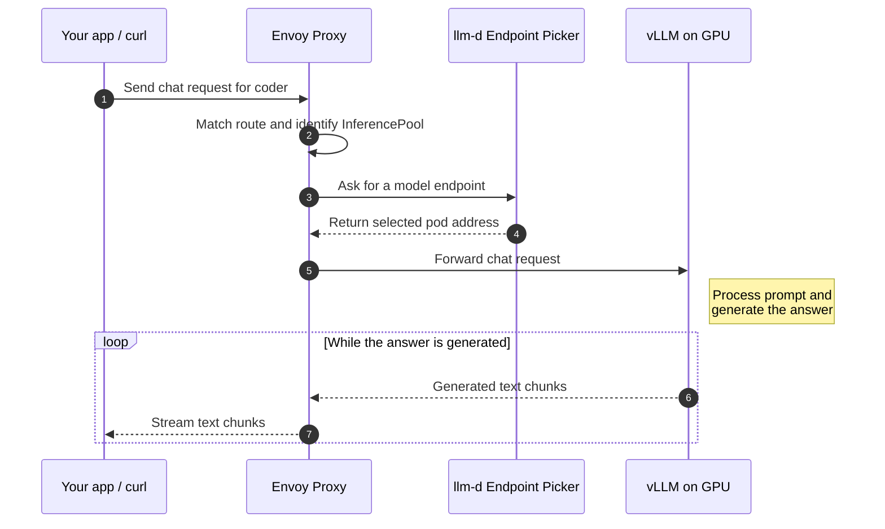

# Serve one small model with KServe

The first example in this repository starts vLLM directly. Here I want to hand that job to KServe and understand what it creates around the model.

We still use the small Qwen model and call it `coder`. A local port-forward reaches Envoy, Envoy asks the llm-d Endpoint Picker for a destination, and the selected vLLM pod generates the answer. KServe maintains the workload, route, and endpoint-selection resources behind that path.

Start with one replica. It is enough to learn the wiring. A second replica needs another available GPU allocation.

## Follow one request

This is the direct gateway request used in the walkthrough. Read the numbered arrows from top to bottom. Solid arrows carry the request or ask for a routing decision; dashed arrows return that decision or stream the answer.



Envoy carries the request and response. The Endpoint Picker chooses the model pod; generated text returns through Envoy. An `InferencePool` describes eligible endpoints and is not another network hop.

KServe's controller creates and maintains the workload and routing resources outside this exchange. With one replica, the picker has only one eligible model destination. Optional LiteLLM sits between the client and Envoy, checking the API key before forwarding the request.

## Before you start

Use a fresh development cluster for the platform installation. This walkthrough targets KServe **v0.20.0** and its release's component versions. Envoy Gateway v1.8 supports Kubernetes v1.32 through v1.35; Kubernetes v1.34 is a reasonable target for this lab. Check the [compatibility matrix](https://gateway.envoyproxy.io/news/releases/matrix/) when choosing a version.

You need `kubectl`, Helm 3, Mike Farah's `yq` v4, and `curl`. The Linux GPU node must already have NVIDIA drivers, container runtime integration, and a device plugin exposing `nvidia.com/gpu`. The installer does not create a node or install GPU drivers. The model uses the pinned `ghcr.io/llm-d/llm-d-cuda:v0.8.0` runtime from KServe's release template. Check that image's hardware and driver requirements for your GPU.

The model requests 2 CPUs, 8 GiB of host memory, and one GPU. The router, tokenizer, and platform controllers need additional CPU and memory. Host RAM and GPU memory are different budgets.

Run all commands from the repository root:

```sh
kubectl config current-context
kubectl get nodes -o custom-columns='NAME:.metadata.name,GPU:.status.allocatable.nvidia\.com/gpu'
```

## 1. Install the platform once

Read [INSTALL.md](INSTALL.md), then run:

```sh
bash kserve/install-platform.sh
```

The script installs cert-manager, the gateway and inference APIs, Envoy Gateway, the Envoy AI Gateway integration, LeaderWorkerSet, and KServe's controller and runtime configurations. The commands are kept visible in the script. It refuses an existing platform rather than adopting shared resources.

Our [gateway configuration](platform/gateway.yaml) creates an internal `ClusterIP` Service through an `EnvoyProxy` setting. There is no public load balancer. The HTTP listener accepts routes from `llm-kserve-demo` and has no hostname match, so the request below needs no custom `Host` header.

## 2. Free the GPU if you ran the first example

The plain example uses `llm-demo`; this one uses `llm-kserve-demo`. A different namespace does not provide another GPU.

If the plain vLLM example is running on your only GPU, stop its model pod first:

```sh
kubectl scale deployment/vllm -n llm-demo --replicas=0
kubectl wait --for=delete pod -l app=vllm -n llm-demo --timeout=5m
```

Skip this step if you have not deployed it. Stopping it interrupts active requests. Its separate LiteLLM pod can remain, but cannot serve answers while its backend is stopped.

## 3. Describe the model, then deploy it

Open [coder.yaml](coder.yaml). It has three main parts:

| Part | What we are asking for |
| --- | --- |
| `model` | Download a pinned Qwen revision and expose it as `coder`. |
| `template` | Run a GPU-backed model pod with a 4,096-token context limit. |
| `router` | Attach to our gateway and let KServe manage the route and scheduler. |

The URI ends in `:7ae5576`, the storage initializer's revision syntax. KServe downloads those files before starting vLLM with the local model directory. `VLLM_ADDITIONAL_ARGS` supplies our demo settings without replacing KServe's startup command or TLS configuration.

The API remains `v1alpha1`, which this pinned release serves. KServe also uses `v1alpha2` internally and in its configuration templates. An API version and a controller release number describe different things.

Previewing the YAML does not contact the cluster:

```sh
kubectl kustomize kserve
```

Apply it and wait for readiness:

```sh
kubectl apply -k kserve
kubectl wait --for=condition=Ready llminferenceservice/coder \
  -n llm-kserve-demo --timeout=30m
```

First startup includes image pulls, model download, and runtime initialization. If the wait times out, inspect the condition and logs before increasing the timeout.

## 4. Look at what KServe created

```sh
kubectl get llminferenceservice coder -n llm-kserve-demo
kubectl get deployments,pods,services -n llm-kserve-demo
kubectl get httproutes.gateway.networking.k8s.io -n llm-kserve-demo
kubectl get inferencepools.inference.networking.k8s.io -n llm-kserve-demo
kubectl get gateway kserve-ingress-gateway -n kserve
```

The workload pod contains vLLM. The scheduler workload contains the Endpoint Picker and, with this release's default template, a tokenizer sidecar. That tokenizer helps the router interpret prompts; it is not another GPU model replica.

An `InferencePool` describes eligible endpoints. The EPP chooses one; Envoy forwards to it. The KServe and Envoy Gateway controllers manage configuration outside the generated-token path. With one replica, there is only one eligible destination, so this does not demonstrate a routing speedup.

## 5. Find Envoy and send a request

Envoy's Service name is generated. Find it by its gateway labels:

```sh
export ENVOY_SERVICE=$(kubectl get svc -n envoy-gateway-system \
  -l gateway.envoyproxy.io/owning-gateway-namespace=kserve,gateway.envoyproxy.io/owning-gateway-name=kserve-ingress-gateway \
  -o jsonpath='{.items[0].metadata.name}')
test -n "$ENVOY_SERVICE"
kubectl get svc "$ENVOY_SERVICE" -n envoy-gateway-system
kubectl port-forward -n envoy-gateway-system "svc/$ENVOY_SERVICE" 8080:80
```

The Service should show `ClusterIP`. Leave the port-forward running. In a second terminal at the repository root:

```sh
curl --fail-with-body --no-buffer \
  http://127.0.0.1:8080/llm-kserve-demo/coder/v1/chat/completions \
  -H 'Content-Type: application/json' \
  --data-binary @kserve/request.json
```

You should receive streaming events ending with `[DONE]`. The wording will vary.

The path is deliberate. KServe's pinned route template matches `/namespace/service/v1/chat/completions`, then rewrites it to `/v1/chat/completions` for the model server. Calling the unprefixed endpoint without the model-routing headers follows a different routing path. Inspect the generated `HTTPRoute` to see the match and rewrite.

The local HTTP listener has no authentication. ClusterIP limits exposure but does not stop other cluster workloads from reaching it. Use this as a development lab. KServe's internal TLS configuration is retained; the local HTTP request does not require disabling certificate checks.

## 6. Add LiteLLM after that works

Follow [litellm/README.md](litellm/README.md) to connect a separate LiteLLM proxy to the gateway's cluster DNS address. It uses the same path prefix and does not create another model Deployment.

The AI Gateway controller is installed for the pinned integration. This example uses KServe's path-based `HTTPRoute`; it does not add an `AIGatewayRoute` for provider conversion or claim token-budget enforcement. PostgreSQL, Redis, autoscaling, and precise prefix-cache routing remain separate exercises.

## If the first request fails

Start with the service conditions, events, and model logs:

```sh
kubectl describe llminferenceservice coder -n llm-kserve-demo
kubectl get events -n llm-kserve-demo --sort-by=.lastTimestamp
kubectl logs -n llm-kserve-demo \
  -l app.kubernetes.io/name=coder,kserve.io/component=workload \
  -c storage-initializer --tail=100
kubectl logs -n llm-kserve-demo \
  -l app.kubernetes.io/name=coder,kserve.io/component=workload \
  -c main --tail=100
```

| Symptom | First thing to inspect |
| --- | --- |
| `Pending` model pod | Events for unavailable GPUs, CPU or memory, taints, or placement rules. |
| Download fails | Storage initializer logs, network access, and the model revision. |
| Model process exits | Main container logs for CUDA, runtime, or memory errors. |
| Webhook error during apply | KServe controller rollout and its cert-manager Certificate. |
| HTTP 404 | Exact request path and HTTPRoute matches, parents, and `Accepted` condition. |
| HTTP 503 | Ready model endpoints, EPP health, route `ResolvedRefs`, and gateway/backend logs. |
| Empty Envoy Service variable | Gateway `Programmed` condition and the two Service selection labels. |

For router problems, list the pods and inspect the scheduler pod's `main` container. Choose its generated name from `kubectl get pods` rather than guessing it.

## Try a second replica, then clean up

With two free GPU allocations, change `replicas` in `coder.yaml` to `2` and apply again. Watch eligible pods and per-pod request metrics. Do not assume the default policy proves precise prefix-cache routing or a particular performance gain.

KServe manages Deployment updates. Do not assume it inherits the plain example's `Recreate` strategy. An update needing a spare GPU can stay pending; removing and redeploying the service is the simple option for this lab when downtime is acceptable.

Stop port-forwards with Ctrl+C. Remove the model and its dedicated namespace:

```sh
kubectl delete -f kserve/coder.yaml --ignore-not-found
kubectl delete -f kserve/namespace.yaml --ignore-not-found
```

The namespace deletion also removes optional LiteLLM resources. Shared platform controllers remain for reuse. If you stopped the plain example, you can restore it with `kubectl scale deployment/vllm -n llm-demo --replicas=1` after the KServe model releases its GPU. Cloud nodes continue to incur charges until you stop or delete them through your provider.

## What has been checked

The example was checked against KServe v0.20.0 source: API schema, runtime arguments, routing template, and dependency versions. Local rendering and schema checks do not establish that the GPU model boots or real traffic reaches it. This example has not been run end to end on a GPU cluster here.

## Sources worth keeping open

- [Pinned KServe installer](https://github.com/kserve/kserve/blob/v0.20.0/hack/setup/quick-install/llmisvc-full-install-helm.sh)
- [Pinned model runtime](https://github.com/kserve/kserve/blob/v0.20.0/config/llmisvcconfig/config-llm-template.yaml)
- [Pinned HTTPRoute template](https://github.com/kserve/kserve/blob/v0.20.0/config/llmisvcconfig/config-llm-router-route.yaml)
- [Pinned scheduler template](https://github.com/kserve/kserve/blob/v0.20.0/config/llmisvcconfig/config-llm-scheduler.yaml)
- [KServe installation guide](https://kserve.github.io/website/docs/install/llmisvc-install)
- [Inference Gateway request flow](https://gateway-api-inference-extension.sigs.k8s.io/#request-flow)
